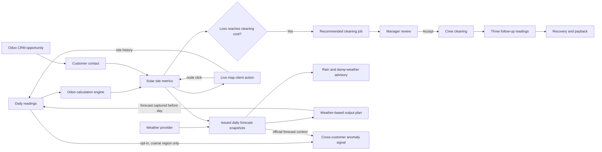

# DustWatch architecture

The `dustwatch` module depends on Odoo Base, Web, Discuss, Contacts, CRM, and Website. CRM leads and opportunities remain the sales front end and use Odoo customer contacts. A CRM Live map button resolves the opportunity to its commercial partner. The Live map client action reads the same `dustwatch.site`, `dustwatch.reading`, and `dustwatch.cleaning.job` records as Fleet priority and the site form. Selecting a node loads that site's full reading and cleaning history; opening a record returns to the canonical Odoo form. Site coordinates are stored on `dustwatch.site`, and the map refreshes from Odoo every 15 seconds. Odoo Website's configured Maps API key enables street tiles; a coordinate map remains available without the key. The `dustwatch.simulator` transient model is used only while the comparison dialog is open.

The engine recalculates stored site fields when readings or site settings change. This keeps the fleet list fast and ensures that list sorting uses stored values.

Weather is opt-in and runs in scheduled Odoo jobs. `dustwatch.weather.forecast` keeps issued forecast snapshots so readings can link to the version available before the Dubai day began. Daily shortwave radiation is converted from MJ/m² to equivalent peak-sun-hours, then multiplied by site capacity and performance factor. This is a planning estimate, not a panel-tilt or inverter simulation. Rain and humidity only add an explainable timing advisory; they do not override the economic cleaning trigger or schedule a job.

Cross-customer analysis is disabled by default. With manager opt-in, a daily job evaluates same-day output shortfalls against stored weather plans. It only persists a coarse-region aggregate after at least three sites from at least two customer contacts agree. No source site IDs, customer names, company IDs, or precise coordinates are stored in a signal. The heuristic is an early-warning experiment, not a trained weather model or an official storm forecast.
