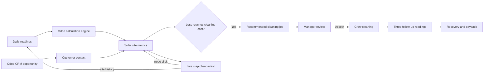

# DustWatch architecture

The `dustwatch` module depends on Odoo Base, Web, Discuss, Contacts, CRM, and Website. CRM leads and opportunities remain the sales front end and use Odoo customer contacts. A CRM Live map button resolves the opportunity to its commercial partner. The Live map client action reads the same `dustwatch.site`, `dustwatch.reading`, and `dustwatch.cleaning.job` records as Fleet priority and the site form. Selecting a node loads that site's full reading and cleaning history; opening a record returns to the canonical Odoo form. Site coordinates are stored on `dustwatch.site`, and the map refreshes from Odoo every 15 seconds. Odoo Website's configured Maps API key enables street tiles; a coordinate map remains available without the key. The `dustwatch.simulator` transient model is used only while the comparison dialog is open.

The engine recalculates stored site fields when readings or site settings change. This keeps the fleet list fast and ensures that list sorting uses stored values.
